# Codyssey B4-1

Ubuntu 서버의 보안과 협업 권한을 설정하고, Bash 스크립트로 앱 상태·시스템 자원을 매분 점검해 로그로 남기는 미션을 수행했습니다. **필수 기능의 구현과 실제 서버 검증을 완료했으며, 수행 결과와 증빙을 아래에 정리했습니다.** 제공 앱의 키 경로가 미션과 달랐던 부분은 호환 설정을 적용했고, 선택 보너스는 수행하지 않았습니다.

## 제출 산출물

| 필수 산출물 | 제출 파일 | 내용 |
|---|---|---|
| 요구사항 수행 내역서 1개 | 이 README | 설정·명령어·수행 결과·필수 증빙 |
| Bash 자동화 스크립트 | [monitor.sh](monitor.sh) | 상태 점검·자원 수집·경고·로그 기록·회전 |

## 미션 수행 결과 한눈에 보기

아래 결과는 실습 당시 실제 서버 기록과 검증 결과입니다. 현재 앱이 계속 실행 중이라는 의미는 아닙니다.

| 미션 요구사항 | 수행 결과 | 확인 자료 |
|---|---|---|
| SSH 포트 20022, Root 원격 로그인 차단 | 유효 설정 및 실제 리스닝 확인 | [SSH 설정](docs/screenshots/05-ssh-security.png), 아래 1절 |
| UFW 활성화, TCP 20022·15034만 허용 | 기본 인바운드 차단·최종 허용 규칙 확인 | [UFW 결과](docs/screenshots/06-ufw-rules.png), 아래 1절 |
| 사용자 3명과 common/core 그룹 구성 | admin·dev는 두 그룹, test는 common 소속 확인 | [계정·그룹](docs/screenshots/07-users-groups.png) |
| 공유·보안 디렉터리 및 ACL | 업로드 공동 쓰기, test의 키·로그 접근 차단 확인 | [디렉터리 ACL](docs/screenshots/08-directory-acl.png), 아래 2절 |
| 일반 계정으로 제공 앱 실행 | Boot 5단계 [OK], Agent READY 및 앱 포트 리스닝 확인 | [부팅 결과](docs/screenshots/04-app-boot.png), 키 경로 차이는 아래 3절 |
| monitor.sh 위치·소유자·권한 | 지정 bin 경로, agent-dev:agent-core, 실효 권한 750 확인 | [스크립트 ACL](docs/screenshots/14-monitor-acl.png) |
| 프로세스·포트 점검, 자원 수집·경고 | 실제 정상 실행·자원 경고 확인, 실패 종료는 대역 시험 병행 | [실행 결과](docs/screenshots/03-monitor-output.png), 아래 4·7절 |
| monitor.log 기록·크기 관리 | 지정 형식으로 누적, 추가 전 10MiB 검사, 현재 로그 포함 최대 10개 | [회전 전](docs/screenshots/13-rotation-before.png), [회전 후 PASS](docs/screenshots/15-rotation-after.png) |
| agent-admin의 매분 cron | 등록 후 연속된 분의 자동 로그 증가 확인 | [cron 등록](docs/screenshots/01-cron-schedule.png), [로그 누적](docs/screenshots/02-cron-log-accumulation.png) |

## 검증 환경과 근거

- **환경:** Ubuntu 24.04 LTS x86-64, Bash, UFW, cron. 미션의 Ubuntu 22.04 LTS 또는 동등 리눅스 환경 조건으로 수행했습니다.
- **실제 서버 검증:** 부팅·권한·프로세스·포트·자원·로그·cron을 확인했습니다. 로테이션은 운영 로그를 보호하기 위해 실제 스크립트의 로그 경로만 임시 폴더로 바꿔 시험했습니다.
- **실패 상황 검증:** 로컬 명령 대역 테스트 6개가 통과했고, 서버 임시 환경에서도 로그 쓰기 실패 시 exit 1을 확인했습니다. 테스트 도구는 Python이며 제출 관제 스크립트는 Bash입니다.
- **수정본 검증:** 오류 처리와 앱 홈 권한을 보강해 서버에 반영했습니다. 기존 캡처와 최신 코드의 차이·검증 범위는 [최종 검토](docs/final-review.md)에, 최초 배포 과정은 [서버 반영 검증](docs/server-deployment.md)에 기록했습니다.

이하에는 각 항목의 설정 명령, 실제 결과, 증빙 이미지를 정리합니다. 명령 블록은 수행 내역이며 일괄 재실행용 설치 스크립트가 아닙니다.

## 1. SSH와 방화벽

SSH는 20022로 변경하고 Root 원격 로그인을 차단했습니다. Ubuntu의 SSH socket 설정도 조정해 최종 IPv4 리스닝 결과에서 20022만 확인했습니다. 포트 변경은 불필요한 기본 포트 접근을 줄이고, Root 로그인 차단은 일반 계정과 필요한 sudo 권한을 사용하게 합니다.

실제 설정 파일은 `/etc/ssh/sshd_config.d/00-mission-security.conf`이며 검증 명령은 다음과 같습니다.

```bash
sudo sshd -t
sudo sshd -T | grep -E '^(port|permitrootlogin) '
sudo ss -4 -ltnp | grep -E ':(22|20022)\b'
```

결과: `port 20022`, `permitrootlogin no`, IPv4 20022 리스닝. 설정 과정에서 잠시 존재했던 22 리스닝은 최종 기록에서 제거됐습니다.

<a href="docs/screenshots/05-ssh-security.png">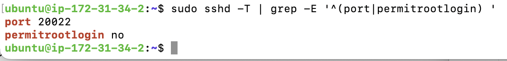</a>

UFW는 활성화했고 기본 인바운드는 deny, 아웃바운드는 allow로 설정되어 있습니다. 전환 중 허용했던 22/tcp 규칙은 삭제했고, 최종 TCP 허용 포트는 20022와 15034입니다. IPv6에도 같은 두 포트의 규칙이 있습니다.

```bash
sudo ufw allow 20022/tcp
sudo ufw allow 15034/tcp
sudo ufw enable
sudo ufw delete allow 22/tcp
sudo ufw status verbose
```

위 명령은 수행 기록을 정리한 것이며 서버에서 재실행할 필요는 없습니다. 기본 deny 정책은 첨부 터미널 기록의 `Default: deny (incoming)`으로 확인했습니다.

<a href="docs/screenshots/06-ufw-rules.png">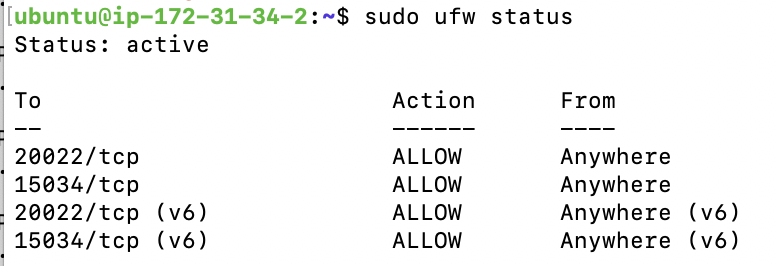</a>

AWS 보안 그룹도 지정 IP에서 두 포트만 허용한 화면을 확보했습니다. 보안 그룹은 호스트 UFW와 별개의 제어입니다.

<a href="docs/screenshots/11-aws-security-group.png">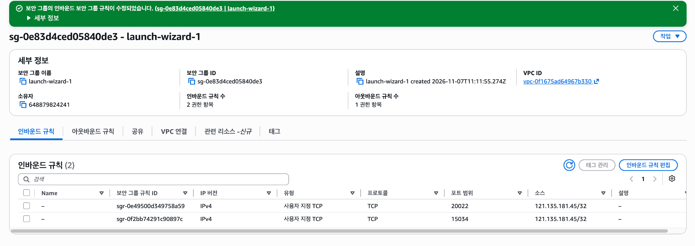</a>

## 2. 계정·그룹·디렉터리 권한

| 대상 | 구성 |
|---|---|
| agent-admin | agent-common, agent-core / 앱·cron 실행 |
| agent-dev | agent-common, agent-core / 스크립트 작성 |
| agent-test | agent-common / QA |
| 앱 홈 | agent-admin:agent-common, 2750 (최종 보강) |
| upload_files | agent-admin:agent-common, 2770 |
| api_keys, /var/log/agent-app | agent-admin:agent-core, 2770 |
| bin | agent-dev:agent-core, 2770 |
| bin/monitor.sh | agent-dev:agent-core, 실효 권한 750 |

앱 홈 자체는 common 그룹의 읽기·통과만 허용해 agent-test가 보안 디렉터리를 이름 변경·교체할 수 없도록 했습니다. upload_files 공유 디렉터리는 common 그룹이 읽고 쓸 수 있고, 키와 로그 디렉터리는 core 그룹으로 제한합니다. 디렉터리의 setgid는 새 파일의 그룹 상속을, 기본 ACL은 하위 파일의 권한 상속을 지원합니다. agent-admin 홈에는 common 그룹의 경로 통과 권한을 부여했습니다.

실제 설정·확인에 사용한 명령 형태입니다. `<대상>`은 해당 디렉터리로 바꾸는 자리표시자입니다.

```bash
sudo groupadd agent-common
sudo groupadd agent-core
sudo useradd -m -s /bin/bash agent-admin
sudo useradd -m -s /bin/bash agent-dev
sudo useradd -m -s /bin/bash agent-test
sudo usermod -aG agent-common,agent-core agent-admin
sudo usermod -aG agent-common,agent-core agent-dev
sudo usermod -aG agent-common agent-test
id agent-admin
id agent-dev
id agent-test
sudo chmod 2770 <대상>
sudo setfacl -d -m g::rwx,m::rwx,o::--- <대상>
sudo chmod 2750 /home/agent-admin/agent-app
sudo setfacl -m g:agent-common:--x /home/agent-admin
sudo getfacl <대상>
sudo chown agent-dev:agent-core /home/agent-admin/agent-app/bin/monitor.sh
sudo chmod 750 /home/agent-admin/agent-app/bin/monitor.sh
```

<a href="docs/screenshots/07-users-groups.png">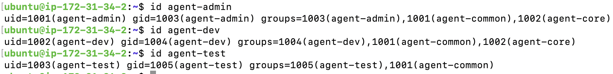</a>

<a href="docs/screenshots/08-directory-acl.png">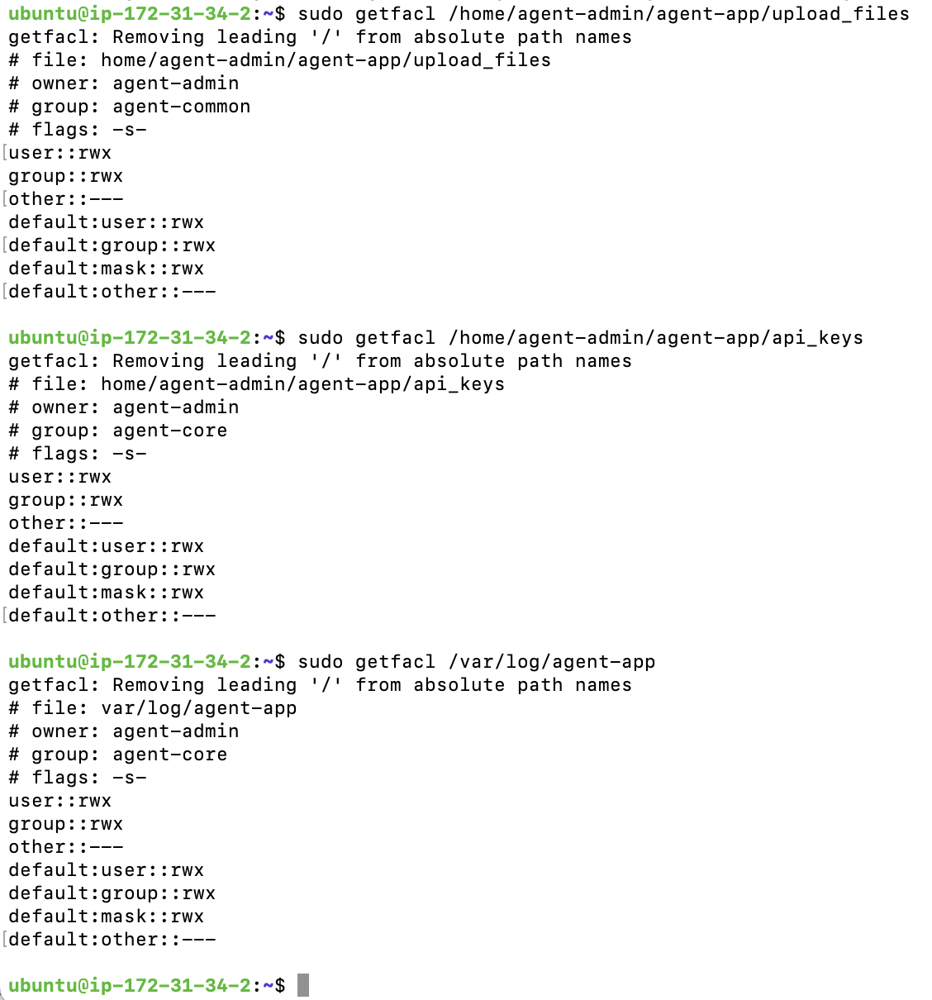</a>

초기 앱 홈은 2770이었으나 최종 재검토에서 2750으로 보강했습니다. 하위 공유·보안 디렉터리 권한은 유지했고 세 계정의 업로드 쓰기, agent-test의 키·로그 접근 차단, agent-dev의 스크립트 쓰기를 서버에서 재확인했습니다. 최신 상태는 [최종 검토](docs/final-review.md)에 정리했습니다.

<a href="docs/screenshots/09-monitor-permissions.png">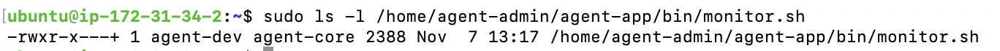</a>

추가로 제공한 상세 ACL 화면에서 스크립트의 `user::rwx`, `group::rwx`, `mask::r-x`, `other::---`를 확인했습니다. 그룹의 실효 권한은 r-x로, 전체 실효 권한은 750입니다. 해당 화면을 아래 증빙으로 저장했습니다.

<a href="docs/screenshots/14-monitor-acl.png">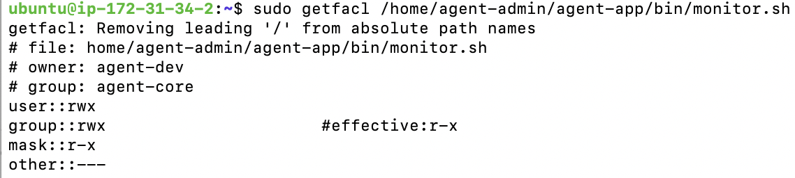</a>

실제 접근 시험에서는 agent-test의 api_keys·로그 디렉터리 접근이 거부됐고, agent-dev·admin의 로그 쓰기는 성공했습니다. 저장소의 실행 비트와 서버의 750 소유권 설정은 구분합니다.

## 3. 제공 앱 실행과 키 경로 호환 처리

실행 환경은 agent-admin의 `.agent-env`에 두고 로그인 시 `.profile`에서 읽도록 구성했습니다. 환경변수의 실제 값과 키 내용은 이 문서에 복사하지 않습니다.

| 환경변수 | 용도 |
|---|---|
| AGENT_HOME | 앱 홈 기준 경로 |
| AGENT_PORT | 앱 포트 지정 |
| AGENT_UPLOAD_DIR | 공유 업로드 디렉터리 지정 |
| AGENT_KEY_PATH | 제공 앱의 키 검색 위치 지정 |
| AGENT_LOG_DIR | 로그 디렉터리 지정 |

미션은 AGENT_KEY_PATH에 `t_secret.key` 파일 경로를 요구하지만, 제공된 x86 실행파일은 api_keys **디렉터리**를 요구했습니다. 파일 경로로 실행하면 `Key Path Mismatch`가 나왔고, 디렉터리로 바꾸면 `secret.key`를 찾는다는 오류가 나왔습니다.

미션의 `t_secret.key`를 보존한 채 동일 내용의 `secret.key`를 준비하고, 앱이 요구하는 디렉터리 경로를 지정해 실행했습니다. 이는 제공 앱과 미션 문구 사이의 차이에 대한 호환 조치이며, 원문과 완전히 같은 설정이라고 주장하지 않습니다. 키 파일 내용은 저장소에 포함하지 않습니다.

```bash
sudo cp /home/agent-admin/agent-app/api_keys/t_secret.key /home/agent-admin/agent-app/api_keys/secret.key
sudo chown agent-admin:agent-core /home/agent-admin/agent-app/api_keys/secret.key
sudo chmod 660 /home/agent-admin/agent-app/api_keys/secret.key
sudo cmp -s /home/agent-admin/agent-app/api_keys/secret.key /home/agent-admin/agent-app/api_keys/t_secret.key && echo '동일 내용 확인'
sudo -u agent-admin -H bash -l -c 'cd "$AGENT_HOME" && ./agent-app-linux-x86'
```

일반 계정 agent-admin으로 5단계 [OK]와 Agent READY를 확인했습니다. 실제 `ss` 결과에서도 IPv4 전체 인터페이스의 앱 포트 리스닝을 확인했습니다.

<a href="docs/screenshots/04-app-boot.png">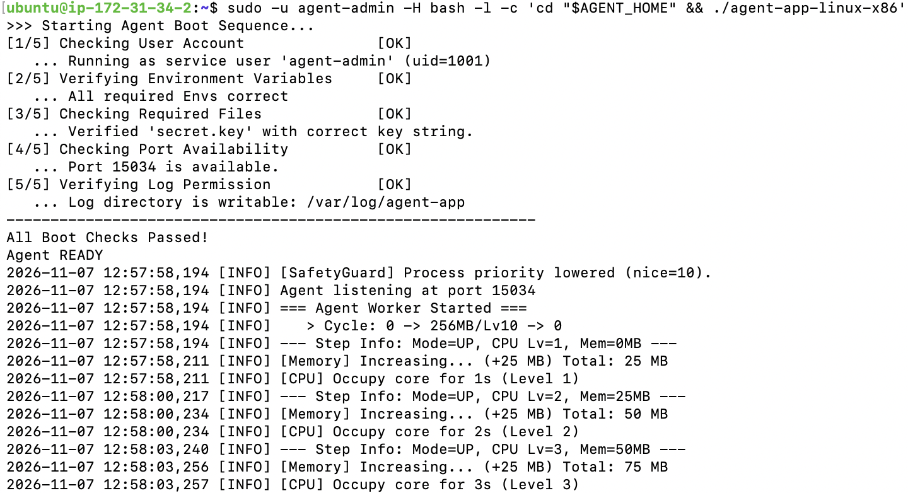</a>

후속 로그인 설정에서 키 경로가 다시 파일로 지정된 것을 확인해, 2026-11-08 제공 앱이 요구하는 디렉터리로 다시 맞췄습니다. 실행 중인 앱을 종료하지 않고 다음 로그인·실행 설정을 수정했습니다.

<a href="docs/screenshots/12-key-path-fix.png">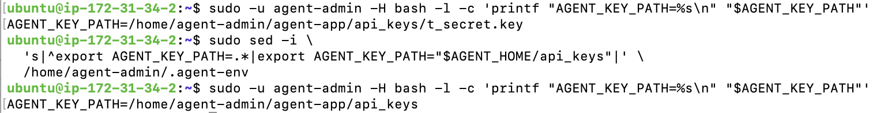</a>

## 4. monitor.sh 구현 및 실행

- agent-admin 소유의 앱 프로세스와 TCP 15034 LISTEN을 확인하며 실패 시 exit 1입니다.
- `sudo -n ufw status`로 방화벽을 확인합니다. 비활성 또는 조회 불가는 WARNING 후 계속합니다.
- 자원 수집은 C 로케일에서 실행하며 명령 실패·누락·잘못된 수치는 ERROR와 exit 1로 처리해 정상 측정값처럼 기록하지 않습니다.
- CPU는 top의 idle 비율을 제외한 값, 메모리는 `(total - available) / total`, 디스크는 루트 파티션 Used %입니다.
- CPU > 20%, MEM > 10%, DISK > 80%이면 WARNING을 출력합니다.
- 로그 형식은 `[YYYY-MM-DD HH:MM:SS] PID:... CPU:...% MEM:...% DISK_USED:...%`입니다.
- 새 줄을 추가했을 때 10MiB(10 × 1024 × 1024바이트)를 넘으면 먼저 회전합니다. 현재 로그와 `.1`~`.9`를 합쳐 최대 10개를 유지합니다. 외부에서 이미 10MiB를 초과하도록 만든 파일을 줄이는 기능은 없습니다.
- 서버에 반영한 보강본은 크기 조회, 오래된 로그 삭제, 파일 이동, 로그 추가 실패 시 ERROR와 exit 1을 반환합니다. 실패한 경우 성공 메시지를 출력하지 않습니다. 회전 도중 실패하면 일부 파일 이동은 이미 수행됐을 수 있습니다.

실제 첫 실행에서는 UFW가 활성인데도 agent-admin의 비밀번호 없는 조회 권한이 없어 WARNING이 나왔습니다. sudoers 설정 후 구문 검사와 비대화식 조회 성공을 확인했고, 이후 WARNING 없이 정상 점검됐습니다. sudoers 파일 내용 자체는 첨부 기록에 출력되지 않았습니다.

```bash
sudo visudo -cf /etc/sudoers.d/agent-ufw-status
sudo -u agent-admin -H sudo -n /usr/sbin/ufw status
sudo -u agent-admin -H /home/agent-admin/agent-app/bin/monitor.sh
```

<a href="docs/screenshots/03-monitor-output.png">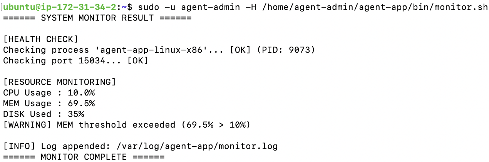</a>

## 5. cron 및 로그 누적

agent-admin의 crontab에 등록한 실제 실행 줄입니다.

```cron
* * * * * /home/agent-admin/agent-app/bin/monitor.sh >> /var/log/agent-app/cron.log 2>&1
```

```bash
sudo crontab -u agent-admin -l
sudo -u agent-admin tail -n 5 /var/log/agent-app/monitor.log
sudo -u agent-admin tail -n 15 /var/log/agent-app/cron.log
```

13:33~13:37 등 연속된 분의 새 로그와 cron 출력에서 자동 실행을 확인했습니다. 표기 시각은 서버 UTC이며 한국 시간과 9시간 차이가 있습니다. cron.log는 콘솔 출력 확인용이고 monitor.log의 회전 대상에는 포함되지 않습니다.

<a href="docs/screenshots/01-cron-schedule.png">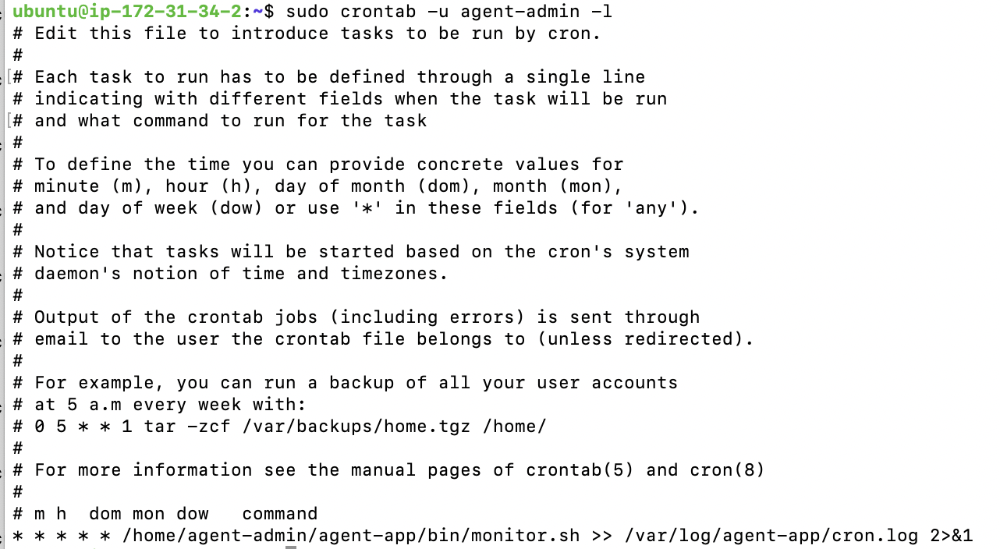</a>

<a href="docs/screenshots/02-cron-log-accumulation.png">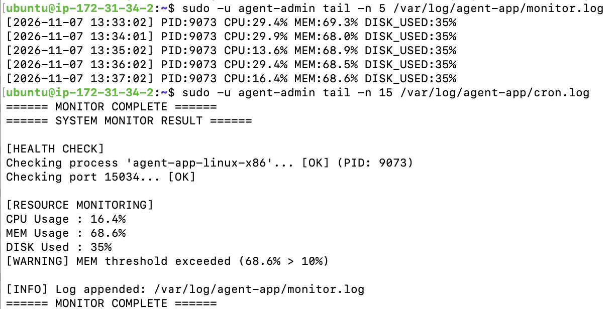</a>

## 6. 로테이션 검증

초기 11MiB 파일 시험은 회전 부분만 분리한 시험입니다. 그 뒤 실제 서버 monitor.sh의 로그 경로 한 줄만 `/tmp`의 새 임시 폴더로 변경해 전체 복사본을 실행했습니다.

- 실행 전: 현재 로그 10,485,760바이트, 기존 회전 파일 9개.
- 실행 후: 현재 로그 65바이트, `.1`은 10,485,760바이트, 총 파일 10개.
- 가장 오래된 마커 제거·순번 이동·새 로그 생성·파일당 최대 크기를 검사해 PASS를 확인했습니다.
- 앞선 작업 디렉터리 권한 경고는 `cd /tmp`를 추가한 재실행에서 해소됐습니다.

<a href="docs/screenshots/13-rotation-before.png">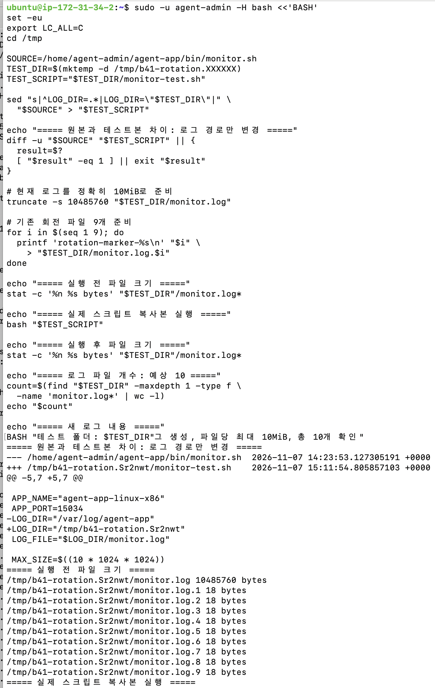</a>

실행 후 크기·총 10개·PASS를 아래 실제 서버 시험 화면에서 확인할 수 있습니다.

<a href="docs/screenshots/15-rotation-after.png">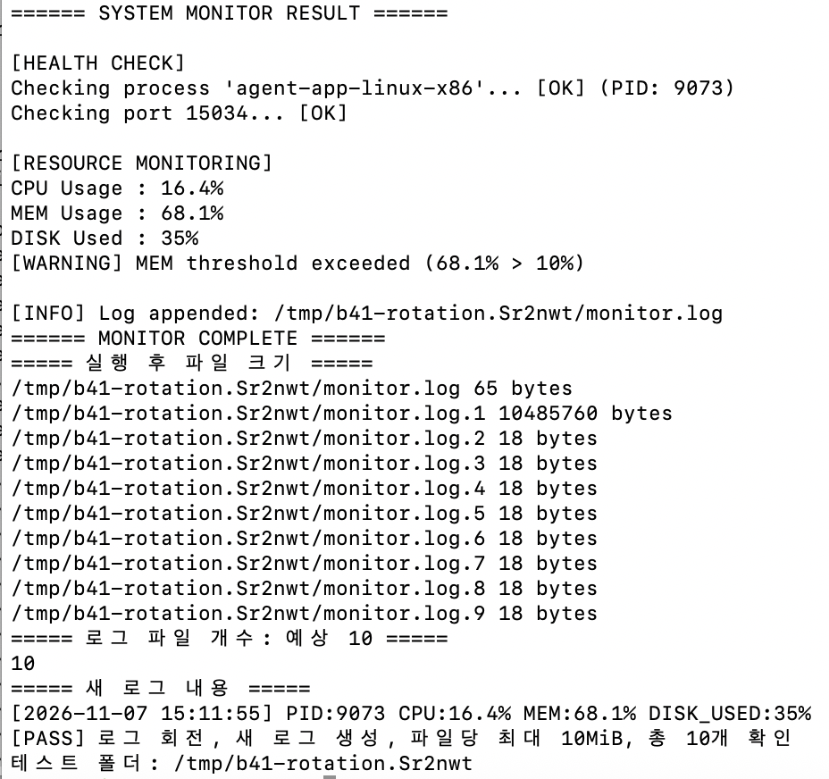</a>

아래 초기 이미지는 별도 회전 로직 시험이며 위 전체 실행과 구분합니다.

<a href="docs/screenshots/10-rotation-test.png">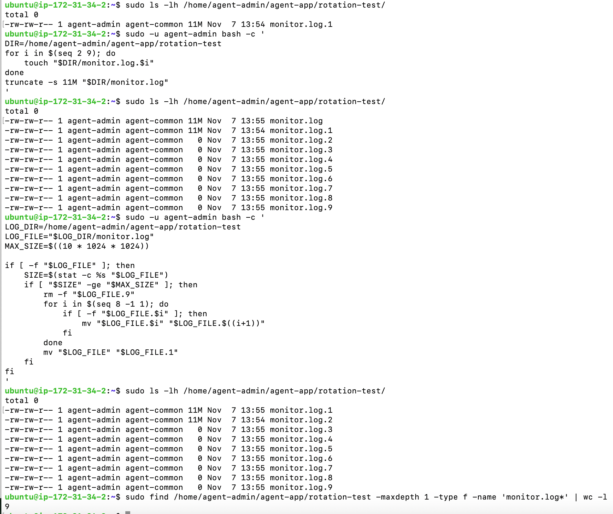</a>

## 7. 로컬 보강본 회귀 검사

```bash
bash -n monitor.sh
python3.12 -m unittest discover -s tests -v
```

6개 테스트 메서드가 통과했습니다. 프로세스·포트 실패, 방화벽·자원 경고 후 지속, 자원 수집 명령 실패·잘못된 출력, 로그 포맷, 10MiB 경계 회전 및 파일 수, 로그 추가 실패와 stat/rm/mv 실패 시 비정상 종료를 검사합니다. 분기별 사례는 subTest로 확인합니다.

이 검사는 Python 표준 라이브러리로 Bash를 호출하고 명령 대역을 주입합니다. 관제 구현 자체는 Bash이며 실제 Ubuntu 명령·방화벽·cron 동작을 로컬에서 재검증한 결과는 아닙니다. 운영 로그는 건드리지 않고 임시 파일만 사용합니다.

Mac에서 실행한 Bash 문법 검사와 로컬 회귀 테스트 6개 통과 결과입니다.

<a href="docs/screenshots/16-local-tests.png">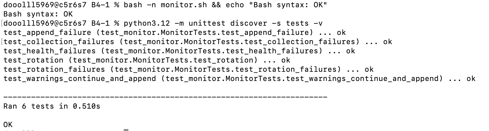</a>

## 수행 범위와 제출 상태

- **필수 구현·검증:** 보안 설정, 계정·권한, 앱 실행, Bash 관제·로그 회전, cron 자동 실행을 수행하고 증빙을 정리했습니다.
- **제공 앱 호환 처리:** 미션 지정 키 파일은 보존했고, 제공 실행파일이 요구하는 디렉터리 경로와 호환 파일을 사용했습니다. 상세 원인과 해결은 3절에 있습니다.
- **최신 서버 반영:** 오류 처리와 앱 홈 권한 보강을 반영했으며, 로컬·서버 코드 해시 일치와 실제 실행 결과는 [최종 검토](docs/final-review.md)에 있습니다. 기존 사진은 보강 전 이력으로 구분합니다.
- **GitHub 제출 상태:** `main` 브랜치에 `README.md`, `monitor.sh`, `.gitignore`, `WORK_LOG.md`, `docs/`의 검증 문서·스크린샷, `tests/test_monitor.py`가 반영되어 있습니다. 최신 문서 내용은 GitHub 저장소에서 확인할 수 있습니다.
- **선택 보너스:** report.sh 요약 통계와 7일 압축·30일 삭제 정책은 미구현입니다.

키·비밀번호·SSH 개인키·원본 환경설정·원본 운영 로그는 저장소에 포함하지 않습니다. 캡처는 제출 증빙으로 보관합니다.
